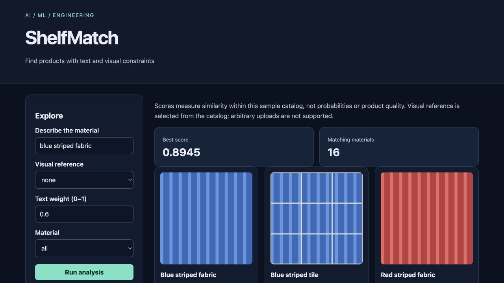

# ShelfMatch

Find products with text and visual constraints for **catalog users**.

Original topic: **Multimodal AI Product** from [the source post](https://www.instagram.com/p/DdyMaogE4ud/).

> Local portfolio implementation developed with Codex assistance. Measured results and limitations are documented; no production adoption, revenue or hiring outcome is claimed.



## What works

- Text and image descriptor retrieval
- Weighted multimodal similarity and material filtering
- Original reproducible swatches and score explanations

[Example output](reports/example-output.json) · [Recorded checks](reports/test-results.txt) · [Learning and interview guide](LEARNING_GUIDE.md)

## Start

Python 3.12 is the validated Python runtime. Run commands from this repository directory. Windows users activate `.venv\Scripts\activate` instead of `source`.

```sh
python3.12 -m venv .venv
source .venv/bin/activate
python -m pip install -r requirements.txt
python generate.py
python app.py
```

Open **http://127.0.0.1:8080**. Keep the process running. Set `PORT` to use another port. The Python development servers are intended for local demonstrations.

## Demonstration

Search blue striped fabric, choose a visual reference, vary the blend weight, and filter to tile. Inspect images alongside text/visual component scores.

## Architecture and decisions

Browser controls → validated Flask API → project analysis/workflow → results and export.

Stack: Pillow · scikit-learn · Flask.

1. Represent catalog text with TF-IDF and images with explicit color histograms plus directional texture descriptors.
2. Combine normalized similarity scores with a visible text/image weight.
3. Use original procedural swatches and deterministic IDs so the entire multimodal example is reproducible.

## Verification

```sh
python -m pytest -q
```

See [VERIFICATION.md](VERIFICATION.md) for actual executed checks, setup verification, model/data results and any outstanding environment limitations. The [recorded CI runs](reports/ci-verification.json) passed for the linked source revision.

## Data and attribution

Authored product cards and images. See [DATA_AND_SOURCES.md](DATA_AND_SOURCES.md) for provenance and usage notes. Original project code is MIT unless a preserved source file or dependency states otherwise. Model and third-party data licenses remain separate.

## Limitations and next improvement

An engineered multimodal retrieval baseline, not a pretrained neural vision-language system. Sixteen synthetic material swatches; visual queries select a catalog reference instead of accepting arbitrary uploads. Similarities are not probabilities.

Suggested extension: Implement image upload with dimension limits and compare its descriptor against the same catalog.

## Honest portfolio use

This implementation and documentation were developed with substantial Codex assistance. Before presenting it, run the demonstration, explain the design choices, and complete the suggested independent modification. Do not describe generated code as work experience, an accepted upstream contribution, or a deployed production service.

## Connect

[LinkedIn — Abhijith Viswanathan](https://www.linkedin.com/in/abhijith-viswanathan-0a7216436/)
